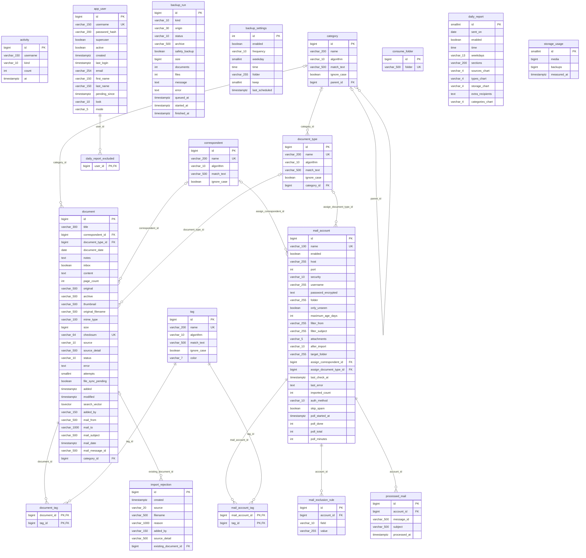

# Datenmodell

Die Datenbank ist in der Java- und der Vaadin-Version identisch, beide spielen dieselben Flyway-Migrationen ein
(Stand: V22). Die Grafik gibt es als [SVG](datenmodell.svg) und [PDF](datenmodell.pdf). Das Diagramm unten zeigt
GitHub direkt an.

| Bereich | Tabelle | Inhalt |
|---|---|---|
| Dokumente | `document` | Ein Dokument mit Original, Archivfassung, Vorschau, Text, Zuordnung und E-Mail-Angaben |
| Dokumente | `document_tag` | Tags eines Dokuments (n:m) |
| Dokumente | `import_rejection` | Abgelehnte Importe mit Grund, bei Duplikaten mit Verweis auf das vorhandene Dokument |
| Stammdaten | `category` | Kategorien in bis zu zehn Stufen, `parent_id` zeigt auf die Stufe darüber |
| Stammdaten | `correspondent` | Absendernamen mit Regel für die automatische Zuordnung |
| Stammdaten | `document_type` | Dokumenttypen mit Regel und optionaler Kategorie |
| Stammdaten | `tag` | Tags mit Farbe und Regel |
| E-Mail | `mail_account` | Postfächer mit Zugang, Abrufregeln, Fortschritt und Zuordnung neuer Dokumente |
| E-Mail | `mail_account_tag` | Tags, die ein Postfach neuen Dokumenten gibt (n:m) |
| E-Mail | `mail_exclusion_rule` | Ausschlussregeln je Postfach |
| E-Mail | `processed_mail` | Bereits verarbeitete Nachrichten je Postfach, damit nichts doppelt kommt |
| Betrieb | `app_user` | Benutzer mit Rolle, Darstellung und Kontostatus |
| Betrieb | `activity` | Aktivitäten der Benutzer für die Übersicht |
| Betrieb | `daily_report` | Einstellungen der täglichen Übersichtsmail (eine Zeile) |
| Betrieb | `daily_report_excluded` | Superuser, die die Übersichtsmail nicht bekommen |
| Betrieb | `backup_settings` | Zeitplan und Ziel der Datensicherung (eine Zeile) |
| Betrieb | `backup_run` | Aufträge für Sicherung, Wiederherstellung und Umzug mit Fortschritt |
| Betrieb | `consume_folder` | Weitere Eingangsordner |
| Betrieb | `storage_usage` | Zuletzt gemessener Speicherbedarf (eine Zeile) |

Löschregeln: Gelöschte Stammdaten lassen die Dokumente stehen, der Verweis wird leer (`SET NULL`). Mit einem
Dokument oder Postfach verschwinden seine Tag-Zuordnungen, Ausschlussregeln und verarbeiteten Nachrichten
(`CASCADE`). `activity.username` und `document.added_by` sind Texte, keine Fremdschlüssel: Sie bleiben, auch
wenn ein Benutzer gelöscht wird.



## Neu erzeugen

Nach einer neuen Migration: eine leere Datenbank starten, die App einmal dagegen hochfahren, damit Flyway alle
Migrationen einspielt, und das Schema auslesen. `tools/datenmodell/datenmodell.py` erwartet in einem Ordner die
Dateien `columns.txt`, `fks.txt` und `uniques.txt` (Ausgabe von `psql -tA -F'|'` auf `information_schema`, die
Abfragen stehen im Skript-Kopf) und schreibt daraus `datenmodell.mmd` und `datenmodell.dot`. Graphviz macht
aus der `.dot`-Datei SVG und PDF:

```bash
dot -Tsvg datenmodell.dot -o docs/datenmodell.svg
```

```bash
dot -Tpdf datenmodell.dot -o docs/datenmodell.pdf
```
